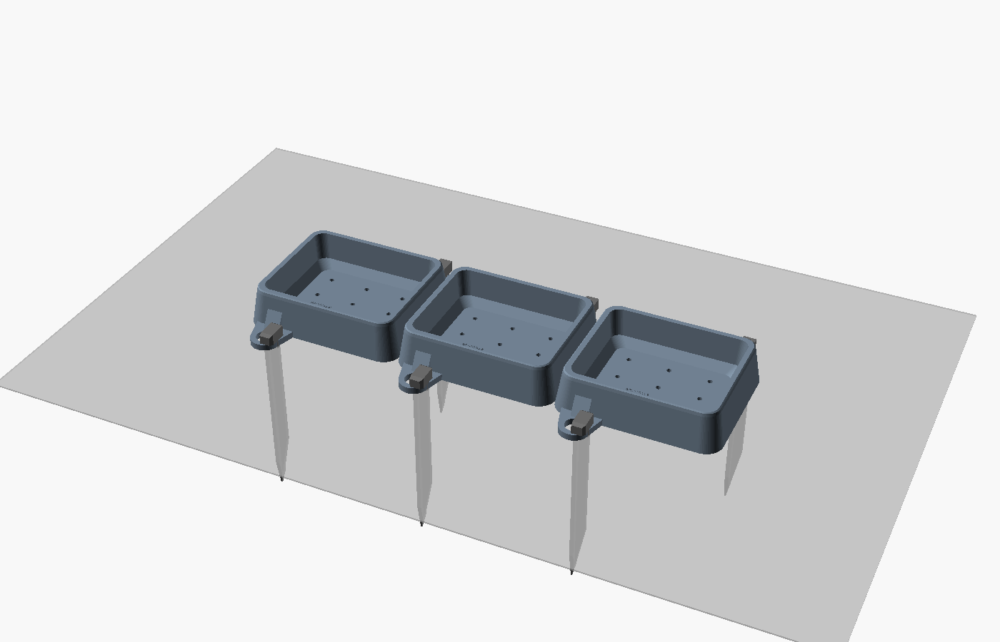

# Broutille

**The feeder that recognises its tortoises.** 3D-printed troughs staked in the ground, one or more cameras, and a Windows app. Broutille films every visit, tells the species, recognises each tortoise, follows its meals, weight and behaviour, and alerts you on your phone when something is wrong.

🌍 English · [Français](README.md) · Español · Deutsch · Português · Italiano · Nederlands · 中文 · 日本語 · 한국어 · ไทย · Tiếng Việt · Bahasa Indonesia. The app, the phone page, alerts, charts and the vet PDF follow the Windows language; change it in **⚙ Settings**.

## What it does

- **Automatic recording**: a clip as soon as a tortoise arrives (3 s before included), at most 2 min.
- **Cameras**: USB webcam, **Wi-Fi IP camera** (Mercusys, Tapo, any RTSP camera — found on the network, tested, no app to keep open), an open window (EZVIZ Studio…, even hidden), RTSP/HLS streams, YouTube pages, video files.
- **Several cameras at once**: feeder, shelter, pond… one watch per camera, a coloured pill each (green watched, red tortoise eating, amber frozen image). Every visit records its camera.
- **Species and individuals**: species by BioCLIP; each tortoise recognised by its shell pattern. Doubtful visits show "Zoé ?" and are confirmed in one click (or with the keyboard in **To confirm**). Click a tortoise in the live video to name it or open its record.
- **Full record per tortoise**: identity (sex, birth date with computed age, arrival, origin, distinctive marks, notes), weighings and weight curve, photo album, learned views, care log.
- **Statistics and behaviour**: meals over 30 days, absences, 10 % weight loss, daily rhythm, who eats with whom, who chases whom, movements, health trend.
- **Vet PDF**: two pages with photos, identity, meals, weight and last visits.
- **Phone page** on your home Wi-Fi (QR code + code): live video, today's meals, records; add a weighing, a note or a photo from the garden.
- **Alerts anywhere** with the free ntfy app: absent tortoise, weight loss, frozen image, monitoring stopped.
- **Vertical clips** (1080 × 1920, the frame follows the tortoise) ready for Shorts, Reels and TikTok.
- **Full screen** for live streaming (YouTube via OBS): names and ages, "LIVE", time, today's meals, nothing private on screen.
- **Daily backup** to a USB stick or OneDrive.

## Install

**One click**: download [`Broutille-Setup.exe`](https://github.com/Oli97430/broutille/releases/latest/download/Broutille-Setup.exe) and double-click it.

- No administrator rights needed. It installs Python 3.11 if missing, then the libraries (about 3 GB, 5 to 30 minutes); a black window shows the progress.
- It adds **Broutille** to the Start menu (and the desktop if you tick the box), plus **Set up Broutille** to repair the libraries.
- Windows may show "Windows protected your PC" because the installer is not signed: click *More info*, then *Run anyway*.
- To update, run the new installer over the old one; downloaded libraries are kept. To uninstall: Windows Settings → Apps → Broutille. Your data is kept.

Then:

1. **🐢 Add a tortoise**: name, species, 3–5 photos.
2. Choose the camera (**📷 IP camera**, **🪟 Window**, webcam…), then **▶ Start**.

Mercusys / Tapo cameras need the **camera account** created in the maker's app (Device settings → Advanced settings → Camera account) — not your Mercusys login.

No graphics card needed (about 3–5 s per analysis on a CPU, 0.5 s with an NVIDIA GPU). User guide (French): [GUIDE.md](GUIDE.md).

## Model licences

| Model | Role | Licence |
|---|---|---|
| Grounding DINO tiny | detection | Apache 2.0 |
| BioCLIP | species | MIT |
| MegaDescriptor-L-384 | individual recognition | **CC BY-NC 4.0, non-commercial use** |

Because of MegaDescriptor, the whole cannot be used commercially as is. Translations were machine-made and checked for completeness, not proofread by native speakers.
