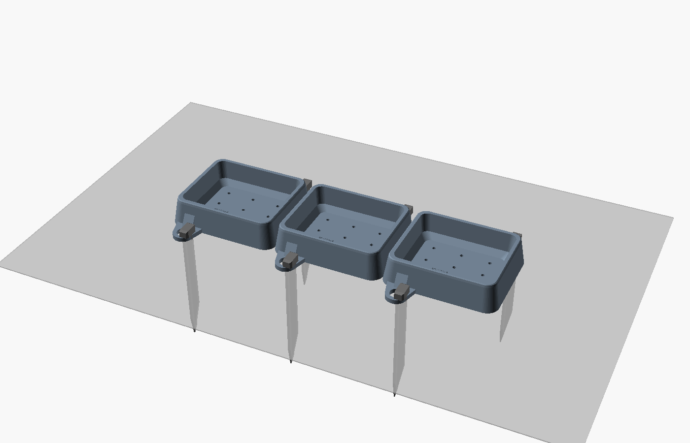
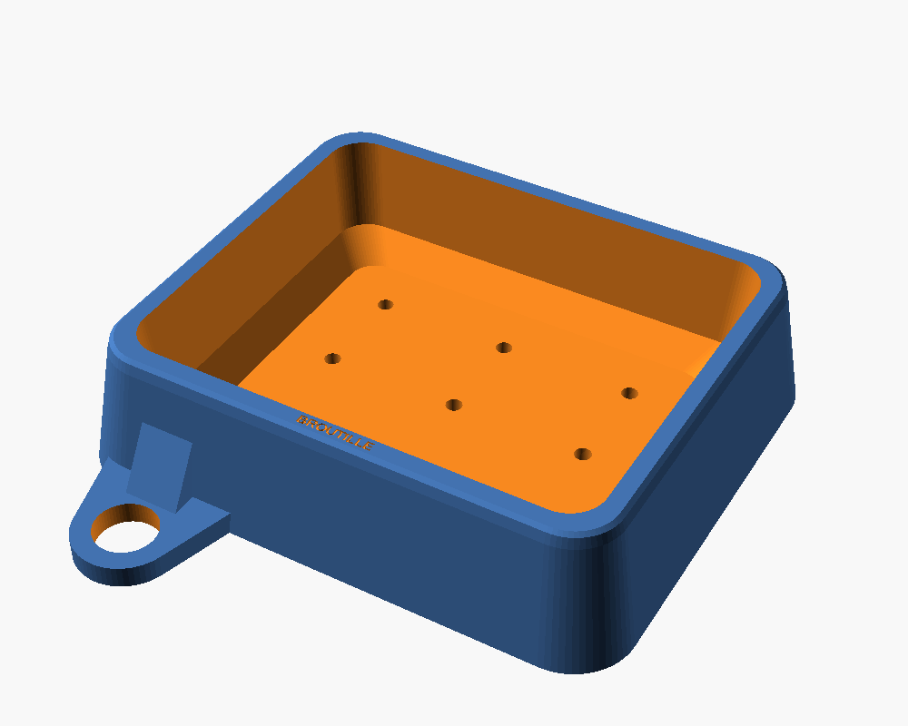

# Broutille

**La mangeoire qui reconnaît ses tortues.** Auges imprimées en 3D, plantées au sol, et application Windows : une webcam, une fenêtre ouverte (EZVIZ Studio...) ou un flux Internet montre la mangeoire de loin, et Broutille enregistre les visites, dit l'espèce et reconnaît chaque tortue.

📖 **[Guide d'utilisation complet](GUIDE.md)**



## Ce que fait l'application

| | |
|---|---|
| 🎥 **Enregistrement automatique** | Un clip dès qu'une tortue arrive, 3 s avant comprises, limité à 2 min même si elle mange une heure. |
| 📺 **Sources au choix** | Webcam USB, fenêtre ouverte avec cadrage à la souris, flux RTSP ou HLS, page YouTube. |
| 🐢 **Tortues seulement** | Les fausses alertes (pierres, mains, ombres) sont écartées ; *Pas une tortue* efface le reste. |
| 🔎 **Espèce** | Radiée ou sillonnée par défaut ; 9 espèces au choix dans *Réglages*. |
| 🏷️ **Individu** | Chaque tortue a sa fiche et sa galerie de photos. |
| ❓ **Prudence** | En cas de doute : « Zoé ? ». Un clic droit confirme, et Broutille retient ces images. |
| 👥 **Plusieurs à table** | Une ligne de journal par tortue. |
| 📊 **Suivi** | Temps de repas par tortue, et alerte en rouge si l'une ne vient plus (3 jours par défaut). |

## Configuration

**La carte graphique n'est pas nécessaire.**

| | Minimum | Conseillé |
|---|---|---|
| Système | Windows 10 ou 11, 64 bits | Windows 11 |
| Processeur | 4 cœurs | 8 cœurs |
| Mémoire | 8 Go | 16 Go |
| Carte graphique | aucune | NVIDIA, 4 Go de mémoire vidéo |
| Disque | 30 Go libres | 50 Go libres |

Temps d'une analyse complète sur un Intel i9-11900 : environ **0,5 s** avec une RTX 3090, **3,3 à 5 s** sur processeur seul, selon le nombre de fils. Une tortue étant lente, c'est suffisant. Pic de mémoire mesuré : 4,5 Go, plus 3,1 Go de mémoire vidéo avec le GPU. Le minimum indiqué pour le processeur est une estimation : aucune machine de cette gamme n'a été testée.

## Démarrer

1. Double-cliquer sur `logiciel/installer.bat`, une seule fois (environ 5 Go sur le disque, Python 3.11 requis).
2. Double-cliquer sur `logiciel/Broutille.bat`. Le premier lancement télécharge les modèles (environ 3 Go).
3. Cliquer sur **🐢 Ajouter une tortue** pour chaque tortue : nom, espèce, puis 3 à 5 photos (face, deux profils, dessus).
4. Choisir la source : webcam, **🪟 Fenêtre** puis **⛶ Cadrer**, ou adresse du flux dans le champ *Caméra*.
5. Cliquer sur **▶ Démarrer**.

## Nommer et corriger

Clic droit sur une visite :

- **✔ Oui, c'est Zoé** : confirme la proposition.
- **Un autre nom** ou **Nouvelle tortue…** : corrige ou crée la fiche.
- **Pas une tortue** : ne sera plus noté.

Clic droit dans *Mes tortues* : renommer, ajouter des photos, ou signaler que deux fiches sont la même tortue.

**Plus vous confirmez, mieux Broutille reconnaît** : chaque confirmation ajoute un angle à la galerie, et une tortue reconnue y ajoute ses autres vues de la visite.

## La mangeoire



Source paramétrique : [`modele_3d/broutille.scad`](modele_3d/broutille.scad) (OpenSCAD 2021.01). STL dans [`modele_3d/stl/`](modele_3d/stl).

| Fichier | Qté | Taille | Orientation | Remplissage |
|---|---|---|---|---|
| `broutille_auge.stl` | 3 conseillées | 200 × 248 × 50 mm | à plat, ouverture vers le haut | 25 % |
| `broutille_piquet.stl` | 2 par auge | 240 × 30 × 16 mm | couché, tel quel | 100 % |

**Réglages** : ASA ou PETG (pas de PLA dehors), couches de 0,2 mm, 4 périmètres, sans supports. Plateau de 256 × 256 mm minimum : l'auge fait 248 mm avec ses pattes. Couleur conseillée : gris moyen mat, pour que la tortue ressorte.

**Pose** :

1. Aligner les auges bout à bout, sur un sol plat.
2. Planter 2 piquets par auge, en diagonale, à travers les pattes, au maillet en caoutchouc.
3. Sol trop dur : remplacer le piquet par une sardine ou un fer à béton Ø 20 mm au plus (trou de 22 mm).

Pas de quincaillerie. Le fond est percé : la pluie s'évacue. Verdure, foin et fruits se posent dans l'auge. Le plastique imprimé garde les saletés dans ses couches : brosser à l'eau régulièrement.

## La vidéo

La caméra reste libre, sans support imprimé, à l'extérieur de la mangeoire. Quelle que soit la source, ces règles donnent les meilleures reconnaissances :

- **Position** : assez haut pour voir le dos, à 30–45° sous l'horizontale. Le dessin des écailles est le meilleur signe d'identité.
- **Taille** : une tortue doit faire au moins 250 pixels à l'écran. Une webcam 1080p à 2 m convient pour des adultes.
- **Fenêtre** : elle ne doit pas être réduite. Le bouton **⛶ Cadrer** retire boutons et autres caméras de l'image.
- **Abri** : une webcam de PC n'est pas étanche.

## Précision mesurée

Sur des photos réelles d'iNaturalist, **pas sur vos tortues** : ces chiffres donnent un ordre de grandeur.

| Mesure | Résultat | Conditions |
|---|---|---|
| Détection d'une tortue | 99,6 % (505/507) | photos variées, GPU |
| Espèce radiata | 93,9 % | une seule image, 362 photos, radiata contre sulcata |
| Espèce sulcata | 98,6 % | une seule image, 143 photos, radiata contre sulcata |
| Bonne tortue en tête | 66 à 86 % | une image, 3 à 10 tortues de même espèce, 1 ou 2 références |
| Inconnue dépassant le seuil, galeries pleines | radiata 4 à 5,5 %, sulcata 1 à 1,5 % | par image, seuil 0,70 ; borne haute, voir plus bas |

Le dernier test compare une tortue inconnue à 2 à 10 fiches de 30 à 60 photos. Chaque fausse fiche réunit des animaux différents, ce qui est pire que la réalité : le chiffre est une borne haute. La marge y est appliquée, mais pas la règle de visite : Broutille exige en plus 2 images sûres à 8 s d'écart ou plus, et que 75 % des images sûres désignent la même tortue. Deux images d'une tortue immobile ne sont toutefois pas deux preuves vraiment indépendantes. Le taux réel par visite n'a pas été mesuré.

## Limites connues

- **Pas encore essayée sur de vraies tortues, ni avec une vraie webcam, ni avec EZVIZ Studio.** Les essais utilisent une vidéo simulée à partir de vraies photos, une fausse caméra, une vraie fenêtre de test et de vrais flux.
- **Fenêtre** : le contenu de certains lecteurs vidéo, dont EZVIZ Studio, n'est capturable que si la fenêtre reste visible à l'écran, sans rien par-dessus. Les bandes unies autour de la vidéo sont retirées seules.
- **Mot de passe RTSP** : masqué à l'écran, mais enregistré en clair dans `%USERPROFILE%\.broutille.json`.
- **Vue libre** : une tortue vue sous un angle absent de sa galerie reste « Inconnue » tant qu'elle n'est pas confirmée. Le début d'utilisation demande donc quelques clics.
- **Sulcata** : carapace moins dessinée que la radiata ; les bonnes conditions de lumière comptent davantage.
- **Croissance** : le dessin d'un juvénile change. Confirmer des visites régulièrement entretient sa galerie.
- **Espèces proches** : Hermann et grecque se confondent souvent (environ 1 fois sur 3 seulement juste). Elles ne sont pas cochées par défaut.
- **Identité** : sur une tortue inconnue, le risque de fausse identité n'est pas nul (voir ci-dessus). Pour un suivi de santé, contrôlez les visites importantes sur le clip.
- **Mangeoire** : ni imprimée ni essayée au sol ; la tenue des piquets est à vérifier selon votre terrain.

## Fichiers produits

Dans `Vidéos\Broutille` :

| Fichier | Contenu |
|---|---|
| `AAAA-MM-JJ_HH-MM-SS.mp4` | clip de la visite |
| `…_<n>_photo.jpg`, `…_<n>_tortue.jpg` | image de la visite, tortue isolée |
| `visites.csv` | date, heure, durée, tortue, espèce, proposition, correction |
| `individus\` | fiches et galeries ; le ménage n'y touche pas |

Par défaut, les clips de plus de 60 jours sont effacés et le dossier est limité à 20 Go. Réglages : `%USERPROFILE%\.broutille.json`. Vidéos et photos restent en local. Une source Internet est lue depuis son serveur, comme dans un navigateur.

## Ligne de commande

```bash
python logiciel/broutille_cam.py --source 0 --dossier visites
python logiciel/broutille_cam.py --source "fenetre:EZVIZ Studio" --dossier visites
python logiciel/broutille_cam.py --source rtsp://192.168.1.20:554/flux --dossier visites
python logiciel/broutille_cam.py --source enregistrement.mp4 --dossier sortie
```

## Développement

```
broutille/
├── logiciel/
│   ├── broutille_app.py        interface Tkinter
│   ├── broutille_cam.py        moteur : présence, suivi, journal, registre des tortues
│   ├── vision.py               détection, espèce, descripteur d'individu
│   ├── sources.py              webcam, fenêtre ouverte, flux Internet, fichier
│   ├── modeles/                vecteurs de référence des espèces
│   └── tests/                  bancs d'essai et test de bout en bout
└── modele_3d/                  source OpenSCAD, STL, aperçus, generer.sh
```

```bash
cd logiciel
python tests/telecharger_photos_test.py 150    # photos de test, une fois
python tests/test_direct.py                    # mode direct : Excel, reconnexion, objet fixe... (1 min)
python tests/test_sources.py                   # vraie fenêtre et flux local
python tests/test_moteur.py                    # bout en bout, environ 3 min sur GPU
python tests/evaluer_reconnaissance.py         # détection, espèce, individus
python tests/evaluer_troupeau.py               # identification en petit troupeau
python tests/evaluer_galerie_pleine.py         # fausses identités contre 60 photos par fiche
python tests/mesurer_processeur.py             # temps et mémoire, sans GPU
python tests/preparer_especes.py               # recalcule les références d'espèces
```

## Modèles et licences

| Élément | Source | Licence |
|---|---|---|
| Détection | [Grounding DINO tiny](https://huggingface.co/IDEA-Research/grounding-dino-tiny) | Apache 2.0 |
| Espèce | [BioCLIP](https://huggingface.co/imageomics/bioclip) | MIT |
| Individu | [MegaDescriptor-L-384](https://huggingface.co/BVRA/MegaDescriptor-L-384) | **CC BY-NC 4.0 : usage non commercial** |
| Lecture des pages vidéo | [yt-dlp](https://github.com/yt-dlp/yt-dlp) | Unlicense |
| Photos de référence et de test | [iNaturalist](https://www.inaturalist.org), Creative Commons | selon chaque photo ; seuls des vecteurs sont livrés |

À cause de MegaDescriptor, l'ensemble ne peut pas être utilisé commercialement tel quel.
